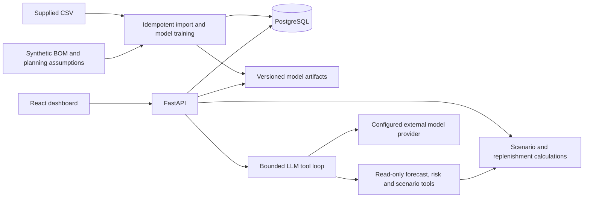

# Tractor supply-chain take-home build plan

## Outcome and scope

Build a polished local application that helps a supply-chain planner answer:

> What should I buy, from whom, and why? What changes if demand rises or a supplier is late?

The demonstration should follow one complete workflow: inspect demand and risk → change a scenario → compare replenishment options → read an evidence-backed explanation → approve a draft purchase order. Implement actual persistence, small trained models, and a grounded LLM integration. Keep the system small enough to explain in five minutes.

Suggested budget: one focused day, approximately 8–12 engineering hours. This is an estimate, not a deadline from the assignment. Deliver a working vertical slice before adding polish. The PDF specifies a 90-minute design stage; it does not establish a take-home implementation deadline.

## What the supplied data supports

Inspected source: `Senior Agentic Engineer Technical Interview Synthetic_Supply_Chain_Dataset.csv`.

| Property | Observed value |
| --- | --- |
| Rows | 10,000 |
| Dates | 2020-01-01 through 2023-12-30 |
| Tractor models | TX-100, TX-200, TX-300, TX-400, TX-500 |
| Suppliers | A–E |
| Warehouses | CA, FL, IL, NY, TX |
| Missing cells | None |
| Exact duplicate rows | None |
| Repeated date/model/warehouse groups | 1,133 groups |
| Repeated date/model/supplier/warehouse groups | 260 groups |
| Demand units per observation | 50–499 |
| Supplier delays | 0–29 days |
| Component failure rates | 0–0.10 |

Columns: Date, Tractor_Model, Demand_Units, Supplier, Supplier_Delay_Days, Component_Failure_Rate, Inventory_Levels, Warehouse_Location, Inflation_Rate, Market_Trend_Index.

Important limitations:

- Row grain and units are undocumented. Repeated dimensional keys are not evidence that rows can be discarded or stock can be summed.
- No component identifier, BOM, component inventory, lead-time promise, unit cost, holding cost, shortage cost, outstanding order, or failure exposure count is supplied.
- A recorded failure rate supports predicting a future rate proxy. It does not support identifying the exact part that will fail or computing statistically justified per-unit failure confidence without exposure data.
- The historical window is approximately four years, rather than the diagram's assumed 7–10 years.
- Supplier averages are very similar: mean delays range approximately 14.48–14.78 days; mean failure rates approximately 4.9–5.1%. This suggests weak supplier differentiation; it does not prove the data has no predictive signal.

### Explicit demo data contract

1. Preserve the CSV unchanged as raw observations, with source row numbers and a dataset checksum. Validate types and ranges during import.
2. Assume each demand observation is an additive contribution to demand. Aggregate to weekly model demand, using complete historical weeks. Document that totals depend on this unverified grain assumption. Exclude incomplete boundary weeks from model fitting.
3. Treat a completely unobserved model/week as missing, not automatically zero. Fit preprocessing on training data only. Record coverage and any imputation policy.
4. Retain inventory observations as historical source data. Never sum repeated inventory snapshots or present them as known component stock.
5. Add a compact, deterministic `demo_assumptions.json`: approximately 6 shared component types, BOMs for 5 models, supplier eligibility, component/warehouse opening stock, base lead times, costs, and any incoming orders. These are synthetic demo assumptions and are labeled in the UI. Do not present them as inferred CSV facts.
6. Use a simulated planning date immediately after the historical window, rather than forecasting from the computer's current date. Allow repeatable replay/reset.
7. Build one clearly labeled stress scenario that produces a shortage. Do not manipulate the historical dataset or reported model metrics to create a more exciting result.

## Architecture

Use React + TypeScript + Vite for the UI; FastAPI + pandas + scikit-learn for the backend; PostgreSQL for persistence. Build the frontend in a Node stage and serve its static output from FastAPI in the app container. This gives two runtime services and one browser origin.



Target startup: `docker compose up --build`, then visit `http://localhost:8000`. PostgreSQL has a health check; the app waits for it, applies migrations, imports once, and loads/trains models once per dataset/configuration fingerprint. Persist the database and trusted, locally generated model artifacts in named volumes. Never deserialize user-supplied model files.

Use a single application process for this dataset. No separate model server, queue, Redis, vector database, Kubernetes, or independent microservices in the first version. Keep the model provider behind one adapter and keep secrets server-side.

## Product experience

Implement one well-designed workspace with three tabs or panels, rather than many shallow pages.

### Overview

- Model, warehouse, and 30/60-day planning-horizon filters.
- Forecast demand, projected shortage, inventory coverage, and modeled replenishment cost cards. Show units, planning date, and source labels.
- Historical/forecast demand chart with an uncertainty band. Weekly forecast resolution is explicit; partial-week allocation is an approximation.
- Ranked risks and recommended actions. Clearly distinguish observed metrics from predictions and scenario assumptions.
- A small data/model quality section: historical period, holdout error, selected baseline/model, and caveats.

### Scenario and decision detail — the standout feature

- Controls for demand change, extra supplier delay, and failure-rate change. Separate what-if assumptions from learned predictions.
- Before/after inventory trajectory with a stockout marker.
- Compare current policy, cheapest eligible supplier, and risk-aware replenishment recommendation under the same assumptions and random draws.
- Show purchase quantity, supplier, expected arrival, projected shortage, leftover stock, and modeled purchase/holding/shortage costs.
- Expandable calculation trace: tractor forecast → BOM requirements → expected usable receipts → net need → supplier/quantity choice.
- Explain why a more expensive supplier might reduce total modeled cost. Avoid claiming measured savings or guaranteed service levels.
- Approve/reject the recommendation. Approval creates an internal draft order and audit event; it never contacts a supplier.

### Assistant

Support a small set of useful questions, such as:

- “Why are you recommending this order?”
- “What happens if demand rises 20% and Supplier C is another 10 days late?”
- “Compare the cheapest supplier with the recommended supplier.”

The LLM can call bounded, read-only tools: `get_forecast`, `get_supplier_risk`, `simulate_scenario`, `compare_replenishment_options`. Cap the loop, validate arguments, set timeouts, and return a structured answer with evidence IDs. Numeric results come from tools; validate structured numeric claims against those results and show the evidence alongside the narrative. The assistant cannot approve orders or run arbitrary SQL.

The app must run without a provider key: use a visibly labeled deterministic explanation template. This is an offline demo mode, not a claim that an LLM is running. With a key configured, demonstrate actual tool calls and show a compact tool trace. On provider failure, preserve the calculations and display the fallback state.

## Model plan

| Task | Inputs available at forecast time | Initial approach | Outputs and evaluation |
| --- | --- | --- | --- |
| Demand | Model, week/calendar, strictly historical demand lags and rolling means | Trailing/seasonal baseline versus regularized regression on pooled weekly model series | Weekly units, 60-day total, empirical uncertainty; MAE and WAPE |
| Supplier delay | Supplier, tractor model, warehouse, calendar, strictly historical supplier delay summaries | Historical supplier baseline versus a small regularized or tree regression | Expected extra delay and empirical delay scenarios; MAE |
| Failure-rate proxy | Supplier/model/warehouse, calendar, strictly historical rate summaries | Historical grouped mean versus a small bounded rate regressor | Expected rate in [0,1], historical spread; MAE |

Train once at initialization or via an explicit developer command; serving a forecast never retrains a model. Use simple preprocessing pipelines and fixed seeds.

Use chronological splits by date, keeping every record from the same date in the same split. Backtest multi-week demand forecasts at rolling origins matching the 60-day horizon. Compute lag features using past records only, and evaluate recursive forecasts without injecting actual future demand. Freeze validation-selected configuration before the final test period. Select the baseline if the more complex candidate does not improve validation results; report the held-out results honestly.

Do not use future observed inflation, market index, inventory, delays, or failures as forecast inputs. Omit macro variables initially; optionally let the user hold the last observed value or supply a scenario path, with clear labeling.

Use resampled, past-only forecast residuals and historical delay/rate scenarios for uncertainty estimates. Validate coverage where data permits and label intervals empirical, not guaranteed. A rate spread is not the same as a binomial confidence interval.

Aggregate demand at model level to reduce sparsity. If warehouse filtering is implemented, allocate model demand using historical warehouse demand shares computed as of the forecast origin; disclose the allocation assumption and do not describe it as an independently validated warehouse forecast.

## Recommendation calculation

Keep optimization deterministic and inspectable; the LLM explains and explores results.

1. Forecast model demand for the planning horizon and translate it into component requirements via the synthetic BOM. Uniformly distribute weekly forecasts for the daily simulator, explicitly as a planning approximation.
2. Load opening usable component stock, existing reservations, and incoming orders from the demo planning ledger. Do not subtract the same reserved demand twice.
3. For each eligible supplier, combine assumed base lead time with predicted/empirical extra delay; model defective receipts using the failure-rate proxy. Reusing CSV aggregate rates across components is an explicit demo approximation.
4. Evaluate a bounded candidate set of order quantities, including no order, around lead-time-plus-review-period need and an uncertainty buffer. Use a seven-day review policy to avoid blindly buying the entire 60-day requirement today.
5. Simulate daily receipts and consumption over 60 days under fixed-seed demand/delay/failure scenarios. Define shortage handling as lost production for the prototype and use the same convention for every policy. Clearly state that this is a component-availability approximation, not a production scheduling model.
6. Rank candidate supplier/quantity actions by modeled purchase cost + holding cost + shortage penalty. Apply eligibility, quantity, and lead-time constraints. Candidate enumeration finds the best tested option, not a globally optimal supply-chain plan.
7. Store the scenario, assumptions, inputs, model version, candidate outcomes, and selected action. Show both modeled cost and shortage outcomes so the choice is reviewable.

Make the planning service handle shared components across models by aggregating BOM requirements before netting inventory. Candidate purchase quantities refer to units ordered; usable receipts account for defects exactly once. A future implementation can add minimum-order quantities, capacity constraints, field-service replacement demand, and a formal multi-period optimizer.

## Persistence and API contract

Minimum entities:

- `dataset_imports`, `raw_observations`: provenance, import checksum, immutable source records.
- `tractor_models`, `components`, `bom_items`, `suppliers`, `supplier_components`: seeded planning dimensions, with synthetic/source provenance.
- `inventory_balances`, `purchase_orders`: current demo stock and incoming receipts. Historical CSV inventory remains separate.
- `model_runs`: dataset/config hash, training cutoff, artifact reference, evaluation metrics.
- `scenarios`, `recommendations`, `audit_events`: persisted inputs, calculated outputs, and approval history.

| Endpoint | Purpose |
| --- | --- |
| `GET /api/health` | Startup/readiness including data and model status |
| `GET /api/metadata` | Filters, units, planning date, provenance, assumptions |
| `GET /api/overview?model=...&warehouse=...&horizon_days=60` | Consistent dashboard snapshot |
| `GET /api/forecasts?model=...&horizon_days=60` | Series, empirical intervals, model metadata |
| `GET /api/supplier-risks` | Delay/rate estimates and historical evidence |
| `GET /api/model-metrics` | Baseline comparison and dated evaluation windows |
| `POST /api/scenarios` | Validate, calculate, and persist a what-if scenario |
| `GET /api/scenarios/{id}` | Retrieve scenario and candidate comparison |
| `POST /api/recommendations/{id}/decision` | Approve/reject with expected version and idempotency key |
| `POST /api/assistant/messages` | Bounded tool-assisted explanation/exploration |

Require responses to carry `as_of`, `model_run_id`, units, and provenance where relevant. Approval uses a transaction and status/version check; retries cannot create duplicate orders. An approval adds on-order inventory, not physically received stock. Reject stale recommendations after conflicting planning changes and offer recalculation.

Use a single named demo planner identity rather than spending the time budget on a login flow. Document that shared production deployment would require authentication and authorization; bind the local demo to loopback by default.

## Build order and stopping points

| Pass | Approximate time | Deliverable |
| --- | --- | --- |
| 1. Foundation | 1–1.5h | Compose, health checks, schemas/migrations, validated idempotent import, deterministic planning fixtures |
| 2. Working calculations | 2–2.5h | Baselines, lightweight candidates, chronological evaluation, inventory simulation and recommendation endpoints |
| 3. Complete user workflow | 2–3h | Charts, scenario controls, comparison, persistent approve/reject flow |
| 4. Grounded assistant | 1–1.5h | Provider adapter, bounded tools, trace, honest offline fallback |
| 5. Submission quality | 1.5–2h | Focused tests, clean-start verification, screenshots, diagram, README and demo script |

Get a working end-to-end baseline early. If time runs short, keep the default 60-day view and aggregate warehouse scope, reduce model tuning, and support explanation of one recommendation before richer assistant conversations. Preserve scenario comparison, provenance, approval persistence, and reproducible startup. Do not add a second framework, complex authentication, streaming chat, live external data, automated supplier ordering, or infrastructure that does not improve the demonstration.

Suggested layout:

```text
backend/app/        # API, database, forecasting, planning, assistant
backend/tests/      # Calculation, leakage, API and persistence checks
frontend/src/       # Workspace UI, charts, API client
data/              # Supplied CSV if sharing is allowed; otherwise documented mount
fixtures/          # Explicit synthetic BOM, inventory, suppliers and costs
docs/              # Architecture, UI screenshot, assumptions and model notes
compose.yaml
.env.example
README.md
```

## Focused verification

- CSV import is validated and idempotent; raw observation counts remain 10,000.
- Test-date observations cannot affect earlier training features, warehouse allocation, or forecasts.
- BOM expansion aggregates shared parts correctly; delayed receipts arrive on the simulated date; stock accounting balances; defects are applied once.
- Controlled fixtures show increasing demand increases component need, and a delayed receipt does not become available early. Do not assume optimized purchase quantity must be monotonic when suppliers or policies can switch.
- Candidate comparison uses identical scenario draws; displayed totals reconcile with calculation details.
- Approving twice creates one order; restart preserves decisions; stale approvals fail predictably.
- Invalid LLM tool arguments are rejected; explanation evidence resolves to stored calculations; missing credentials/provider timeout produces a visible fallback.
- From a clean environment, one command starts the app, seeds data, produces a forecast, and supports the scenario/approval workflow. A build requires dependency downloads; after images and artifacts are ready, offline mode needs no external model service.

## Submission and five-minute demo

Include a concise README with startup instructions, architecture diagram, data assumptions, model evaluation table, known limitations, and the exact demo path. Add one strong screenshot and, if time permits, a short recording. Use lockfiles and pinned container/dependency versions selected during implementation.

Demo sequence:

1. Show the actual dataset period and source/assumption labels.
2. Open the saved stress scenario and show forecast demand plus a projected component shortage.
3. Increase demand or supplier delay; show the trajectory and cost/risk comparison update.
4. Ask why the recommended supplier/quantity was chosen; open the supporting calculation/tool trace.
5. Approve a draft order, refresh, and show persisted status and incoming supply.
6. Show the baseline/model evaluation briefly, including a baseline win if that is what the data supports.

What makes this stand out: a complete decision loop, visible economic tradeoffs, inspectable agent tools, honest ML evaluation, and a reproducible demo. Complexity should earn its place through a visible user benefit.

## Implementation references

- [FastAPI container deployment](https://fastapi.tiangolo.com/deployment/docker/)
- [Docker Compose: single-command multi-service environments](https://docs.docker.com/compose/intro/features-uses/)
- [scikit-learn: chronological evaluation and time-series splits](https://scikit-learn.org/stable/modules/cross_validation.html#time-series-split)
