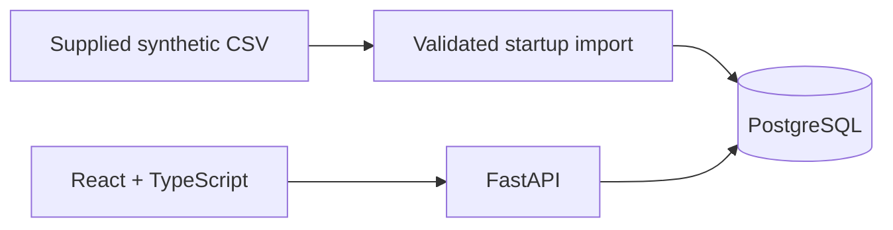

# Tractor Supply Planning

A full-stack prototype for helping a tractor manufacturer anticipate demand, supplier delays, and component failures, then choose inventory purchases.

**Current increment:** a React dashboard backed by FastAPI and PostgreSQL, with validated, persistent CSV ingestion, historical demand, supplier averages, and model/warehouse filters. Forecasting, synthetic component planning data, scenario comparison, and recommendation approval are planned in [BUILD_PLAN.md](BUILD_PLAN.md).

The intended workflow is **forecast demand → identify component shortages → compare purchasing options → explain the recommendation → approve a draft order**.

## What is implemented

- Filter historical demand and supplier records by tractor model and warehouse.
- Inspect weekly demand and recorded supplier delay/failure-rate averages.
- Preserve and validate the supplied dataset, with atomic imports keyed by file checksum.
- Start the application and persistent database through Docker Compose.

The dashboard currently shows historical observations. ML predictions, scenario planning, and the LLM assistant are future increments.

## Architecture



The frontend is compiled with Vite and served by FastAPI. Two containers run at demo time: the application and PostgreSQL.

## Run

Install/start Docker with the Compose plugin, then run from this directory:

```sh
docker compose up --build
```

Open **http://localhost:8000**. API documentation: **http://localhost:8000/docs**. Defaults work without an `.env` file. Optionally copy `.env.example` to `.env` and change the local password or port.

Once the application is healthy, try selecting a tractor model and warehouse; the demand chart, summary counts, and supplier table should update together.

Initial builds require network access to container and package registries. Once dependencies are built, this increment needs no external service or model credentials. Both the UI and API use the same origin. Only the application is exposed, bound to loopback; PostgreSQL is internal to Compose. The demo has no login and is intended for local use.

```sh
docker compose ps
docker compose logs app
docker compose down
```

The database persists across restarts. Imports are atomic and keyed by the CSV SHA-256 checksum; repeated starts do not duplicate observations. A changed file creates a separate import, and the application queries only its current dataset. To intentionally delete all local database state, use `docker compose down --volumes`.

## API

| Endpoint | Returns |
| --- | --- |
| `GET /api/health` | Database/dataset readiness and imported row count |
| `GET /api/metadata` | Model and warehouse filters, data coverage, source checksum, assumptions |
| `GET /api/overview?model=TX-100&warehouse=CA` | Historical summary, weekly demand, and supplier averages; filters are optional |

Interactive endpoint definitions are available at `/docs` once the app is running.

## Dataset and assumptions

`data/supply_chain.csv` is a copy of the supplied synthetic interview dataset: 10,000 rows, January 2020–December 2023, 5 tractor models, 5 suppliers, and 5 warehouses. Confirm permission to redistribute it before publishing a public repository.

- Row grain is undocumented. For this explorer, demand observations are **assumed additive** and summed by week. No rows are silently discarded based on repeated dimensional keys.
- Counts and demand totals cover all selected history; the chart shows the latest 26 observed weeks. Calendar boundary weeks may be partial. Missing weeks mean unobserved data, not zero demand.
- Supplier averages are **historical observations**, not predictions. Failure rates are means of recorded rate values, not exposure-weighted estimates.
- Recorded inventory snapshots are preserved in PostgreSQL and are **not summed or interpreted as current component stock**.
- No components, costs, BOMs, or current stock are invented in this increment.

## Development

Backend: Python 3.12; frontend: Node 22. The container build handles both.

For frontend development against a running Compose application:

```sh
cd frontend
npm install
npm run dev
```

Vite proxies `/api` to `localhost:8000`. `npm run build` performs a TypeScript check before bundling.

Versions are pinned at the top level. A frontend dependency lockfile still needs to be generated in a network-enabled environment and committed; then switch the Docker build to `npm ci` for fully repeatable transitive resolution.

## Verification status

Verified locally: Python source syntax, Compose configuration, import validation of all 10,000 rows (2,732,321 demand units under the additive assumption), and rejection of empty/malformed files, negative demand, and non-finite failure rates.

Full container startup, SQL execution, and frontend build have **not yet been verified**: the development session has no running Docker daemon and cannot reach dependency registries. Do not treat the scaffold as a validated demo until the clean-start smoke check passes.

Smoke check: start Compose, check `/api/health` reports 10,000 rows, change both filters, verify the chart/table update, restart the app, and confirm the row count remains 10,000.

## Next increments

1. Validate the container build and complete the first end-to-end smoke check.
2. Add explicit mock components, bills of materials, current inventory, and supplier costs.
3. Add demand, supplier-delay, and failure-rate baselines with chronological evaluation.
4. Compare replenishment actions under demand and delay scenarios, then persist draft-order approvals.
5. Add an LLM assistant that explains results using bounded calculation tools.

See [BUILD_PLAN.md](BUILD_PLAN.md) for the model/data contract, API design, evaluation approach, and demo script.
