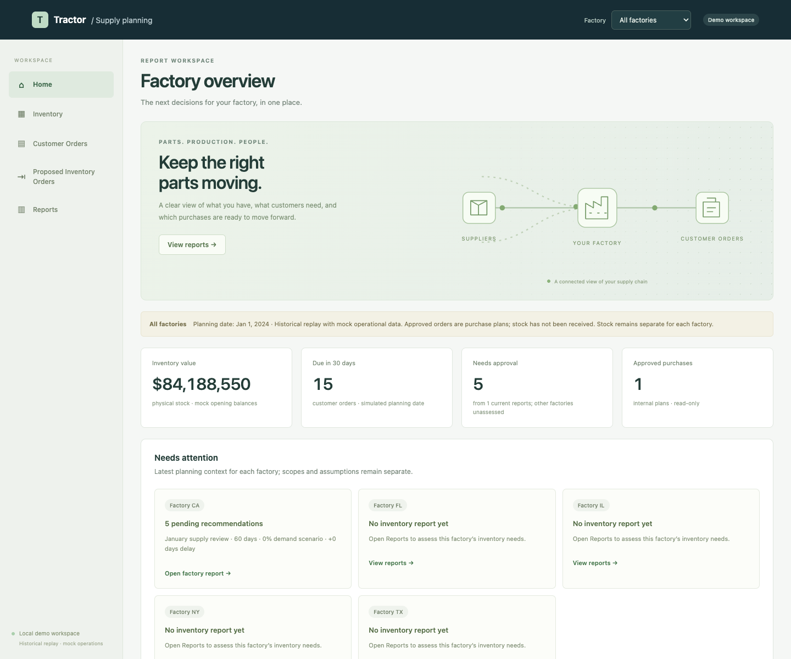
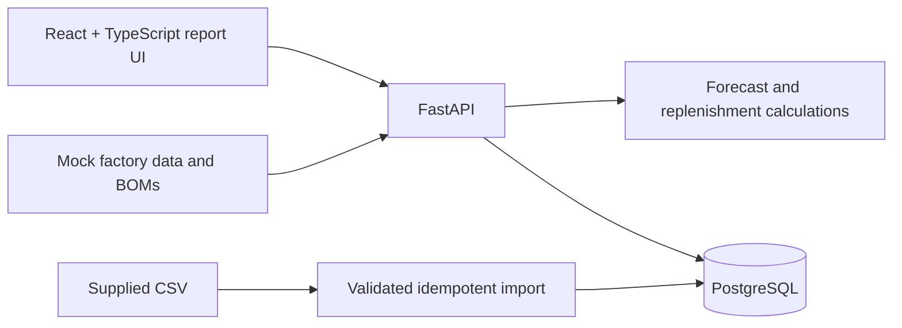

# Tractor Supply Planning

A local full-stack supply-chain report dashboard for five tractor factory locations. Configure the questions to answer, review forecasts and operational context, then approve or deny proposed inventory purchases.

## Run

With Docker running:

```sh
docker compose up --build -d
```

Open **http://localhost:8000**. Interactive API documentation is at **http://localhost:8000/docs**. No model-provider credentials are needed for this increment. Initial builds download dependencies; subsequent report runs use the local database.

Optional configuration: copy `.env.example` to `.env` to change the local database password or application port. The application binds to loopback and the database is internal to Compose. This is a local demonstration with no login.



Screenshots: [Report library](docs/reports-library.png) · [Planning report](docs/report-dashboard.png)

## Report workflow

1. Open **Reports** and choose **New report**. Give the report a name, select its **Report factory / state**, then select any combination of **demand forecast**, **supply risk**, **component failure**, and **inventory recommendations**.
2. Set a **7–90 day horizon**, forecast model, demand change, and additional supplier delay.
3. Run the report. Each run saves a named, immutable calculation snapshot and its configuration in PostgreSQL.
4. Review the forecast, risk estimates, current inventory, customer orders, and supplier/shipping comparisons.
5. Approve or deny each inventory recommendation. Approval creates an internal planned purchase order; physical inventory remains unchanged. Run another report to include planned incoming supply.
6. Search the report library by name and reopen existing reports for the selected browsing scope, export JSON, or print a report. New report creation appears only on the Reports list.

The model selector filters the forecast and customer orders. Shared components and replenishment decisions always account for **all factory models**. Inventory recommendations calculate their demand/risk dependencies even if the corresponding charts are not selected.

The global selector offers **All factories**, California (CA), Florida (FL), Illinois (IL), New York (NY), and Texas (TX). It filters browsing across Home, Inventory, Customer Orders, Proposed Inventory Orders and Reports, and persists across navigation and reloads. All factories combines lists and summary totals while keeping every stock position, customer order and approved purchase labeled by factory. Stock is never pooled between locations.

**Report factory / state is an independent selector inside report configuration.** Each report calculates one factory. A specific global selection prefills a new report, while All factories requires an explicit report factory. Running or opening a report does not change the global browsing filter. Saved reports and bookmarks preserve the two scopes independently.

For this demo, CSV warehouse codes are treated as factory locations. Each factory has separate history, mock stock, customer orders, planned purchases and revision state. Existing single-factory reports and orders remain assigned to CA.

## Workspace pages

- **Home:** a subtle animated supply-chain illustration, factory summary cards, upcoming customer orders, and pending needs from the latest inventory report. Stale reports are labeled and not treated as current needs. The animation respects reduced-motion settings.
- **Inventory:** physical balances, reservations, available stock and approved incoming units. This page works without generating a report.
- **Customer Orders:** all mock orders for the factory, including orders beyond the default report horizon. Search and status filters are available.
- **Proposed Inventory Orders:** every approved recommendation for the factory, with quantity, cost, expected arrival and a source-report link. The page is read-only; no receipt or external purchasing action is performed.
- **Reports:** a searchable, consistently top-aligned list for the current browsing scope and the only place to start a new report. Report detail retains analysis configuration and approve/deny decisions.

In All factories mode, Home shows separate planning context for each factory, preserving differences in report horizon, scenario settings and freshness.

The sidebar provides those five destinations. Clicking the Tractor logo opens Home. On narrow screens, workspace navigation becomes a scrollable horizontal bar. Navigating to Reports resets scroll position and keeps short and empty lists aligned with the top of the workspace.

## What is real and what is synthetic

| Area | Implementation |
| --- | --- |
| Historical source | Supplied synthetic interview CSV: 10,000 observations, 2020–2023, five models, five suppliers and five warehouse codes |
| Report location | Selected factory; only its observations feed forecasting and risk baselines |
| Planning date | January 1, 2024, a historical replay following the dataset |
| Demand forecast | Real calculation: trailing mean of eight complete observed weeks, scaled to the selected horizon and demand scenario |
| Demand uncertainty | Empirical 10th–90th percentile of recent observed weeks; not a calibrated confidence interval |
| Evaluation | Last eight complete observed weeks held out, with MAE and WAPE; no future demand is used to make the held-out forecast |
| Supplier delay | Historical mean extra delay plus the configured scenario; historical p90 shown separately |
| Component failure | Historical mean supplier failure-rate proxy, reused for expected defective component receipts |
| Operational planning | Explicit mock BOMs, component stock, reservations, supplier costs/base lead times and customer orders |
| Recommendations | Deterministic supplier/shipping candidate ranking using purchase, holding and component-shortage costs |
| Decisions and orders | Actual transactional PostgreSQL persistence, duplicate-approval protection and stale-snapshot checks |

Forecasting is currently a **statistical baseline**, not a trained ML model or LLM. Aggregate failure rates do not identify which individual component will fail. The report exposes its assumptions and limitations.

Operational fixtures live in [`backend/app/fixtures/planning.json`](backend/app/fixtures/planning.json). Physical stock is seeded separately for each factory only when a component is first initialized; edits to fixture stock do not silently overwrite an existing database. Customer orders are deterministic fixture data shown at the simulated planning date. Factory stock/order scaling factors are explicit mock assumptions. Inventory and incoming supply are not pooled between factories. The original CA ledger is preserved during the additive schema migration.

## Calculation details

- CSV row grain is undocumented. Demand observations are assumed additive. Complete observed weeks are aggregated per model; missing weeks are unobserved, not automatically zero. A missing week should be filled with zero only when the source is known to be a complete transaction log where no row means no demand. If reporting may be incomplete, keep the value unknown and repair or exclude it; do not interpolate demand without evidence.
- Missing-week handling affects forecast evaluation: the current baseline and holdout use observed complete weeks in sequence, so gaps can make adjacent points span more than one calendar week. Scores are exploratory until row semantics and gap treatment are confirmed. Partial boundary weeks are excluded from weekly calculations.
- Confirmed orders replace daily forecast demand when larger, preventing addition of the same order demand twice. Mock reservations represent separate pre-horizon production.
- Tractor demand expands through each model’s BOM. Requirements for shared components are combined before netting available stock and expected usable incoming receipts.
- Historical CSV inventory is preserved separately; it is never summed into current component stock.
- Standard delivery combines the fixture’s base lead time with the historical supplier delay estimate. Expedited delivery assumes three days plus scenario delay and a 40% price premium; this is a demo assumption.
- Each component compares no purchase against eligible suppliers with standard/expedited shipping. Purchase quantities cover net horizon requirements after the expected defect rate. Ranking uses 25% annual holding cost and a per-component shortage penalty of three times unit cost.
- This is a bounded, single-purchase comparison, not a global optimizer or a tractor production scheduler. Component shortage costs are proxies; modeled cost differences are not measured business savings.
- Approval is an internal planning action and never contacts a supplier. Concurrent retries create one planned order. Conflicting decisions and approvals from stale reports are rejected. Decisions within the same report can be processed sequentially.

## Architecture



Vite builds the frontend in a Node stage, then FastAPI serves the resulting assets. Two containers run: the app and PostgreSQL. Frontend dependencies are locked and installed with `npm ci`.

## API

| Endpoint | Purpose |
| --- | --- |
| `GET /api/health` | Application/data readiness |
| `GET /api/report-options` | Available factories, planning date and models |
| `GET /api/workspace` | Combined factory lists and totals with per-factory planning context; stock remains separate |
| `GET /api/factories/{site}/workspace` | Current inventory, all customer orders, approved purchases, and latest inventory-report context; creates no report |
| `POST /api/reports` | Validate configuration, calculate and save a report |
| `GET /api/reports?factory=CA` | Named saved reports for the factory, newest first; filter optional for API clients |
| `GET /api/reports/{id}` | Saved results with current decision status and stale flag |
| `POST /api/reports/{id}/recommendations/{component}/decision` | Save `approved` or `denied`; approval creates one internal order |
| `GET /api/metadata`, `GET /api/overview` | Original source-data explorer APIs, retained for historical inspection |

Example report request:

```json
{
  "factory": "TX",
  "horizon_days": 60,
  "model": "",
  "demand_change_pct": 20,
  "extra_delay_days": 5,
  "analyses": ["demand", "supply", "failure", "inventory"]
}
```

## Development and checks

Python 3.12 backend; React/TypeScript frontend. To develop the frontend against the running backend:

```sh
cd frontend
npm ci
npm run dev
```

Vite proxies `/api` to `localhost:8000`. `npm run build` checks TypeScript and produces the frontend bundle.

Calculation tests use the Python standard library:

```sh
PYTHONPATH=backend python3 -m unittest discover -s backend/tests -v
```

API lifecycle tests require a fresh, isolated database and are skipped unless `REPORT_TEST_URL` points to an **isolated test instance**. They create reports and orders. They were verified against a separate temporary PostgreSQL database and an app instance on port 8001:

```sh
REPORT_TEST_URL=http://localhost:8001 PYTHONPATH=backend python3 -m unittest discover -s backend/tests -v
```

Tests cover receipt timing, demand scenarios, future-data isolation, shared-component requirements, reservations, avoiding duplicate order demand, sufficient stock, configuration validation, concurrent duplicate approvals, conflicting decisions, stale reports, factory isolation, operational pages without reports and incoming supply. Browser checks cover the five navigation pages, global All-factories browsing, independent report factory selection, scope persistence, report-only creation, top alignment at different viewport heights, empty search results, scroll reset, approval visibility, read-only orders, reduced motion, report configuration, saved results, exports and mobile overflow.

## Persistence

```sh
docker compose ps
docker compose logs app
docker compose down
```

Named database volumes preserve source imports, operational stock, reports and decisions. Imports are atomic and checksum-keyed. `docker compose down --volumes` intentionally deletes **all local demo database state**, including decisions.

## Next increments

Compare the statistical baselines with trained models using chronological evaluation, add an LLM that explains tool-computed results, and refine replenishment with more realistic supplier capacity, receipt events and multi-period ordering. See [BUILD_PLAN.md](BUILD_PLAN.md) for the original design and broader roadmap; this README describes the implemented version.
