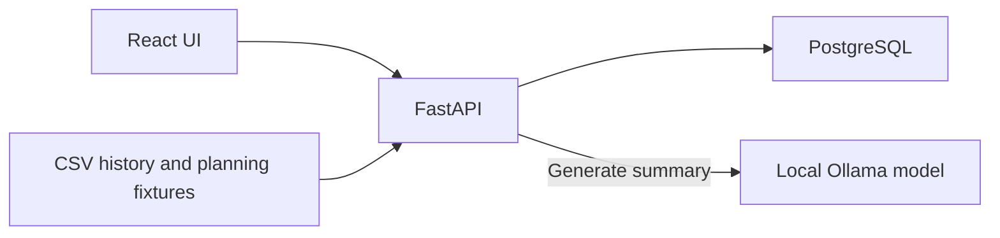

# Implementation notes

For startup and a tour of the app, see the [README](../README.md).

## Services and data flow

The service has a React/TypeScript frontend, a FastAPI backend, and a PostgreSQL database. The Docker build compiles the frontend; FastAPI serves that bundle and `/api` routes together on port 8000. In development, Vite proxies `/api` requests to that backend.

| Compose service | Responsibility | Access and persistence |
| --- | --- | --- |
| `app` | FastAPI API, calculations, saved-report actions, and built React UI | Host `127.0.0.1:8000` by default; `APP_PORT` changes the host port |
| `db` | PostgreSQL 17.6 source data and operational state | Internal port 5432; `postgres_data` volume |
| `llm` | Ollama 0.40.15 serving the optional `qwen3:1.7b` model | Internal port 11434; `ollama_models` volume; model downloaded separately |



The app can start and calculate reports while the model is unavailable. Summary generation is an explicit action on a saved report. The model receives bounded facts from that snapshot; calculations and approval transactions remain backend operations.

## Database storage

Startup imports source observations by checksum and applies additive schema changes. Operational state is partitioned by factory. Existing reports, orders, and stock are preserved across restarts and imports.

| Table | Primary key | Stored data |
| --- | --- | --- |
| `dataset_imports` | `checksum` | Import filename, observation count, and import timestamp |
| `observations` | `(dataset_checksum, source_row)` | Validated source observations, including the synthetic extension |
| `factory_state` | `site` | Revision counter used for approval locking and stale-report checks |
| `factory_inventory` | `(site, component_id)` | Physical on-hand and reserved component balances |
| `report_runs` | `id` | Name, factory, configuration, calculation snapshot, source checksum, inventory revision, deletion timestamp, and demo lock |
| `planning_purchase_orders` | `id` | Approved internal purchase plans linked to their originating report; unique per report/component |
| `recommendation_decisions` | `(report_id, component_id)` | Approved/denied decisions, decision timestamp, and optional purchase-order ID |
| `report_summaries` | `report_id` | One saved explanation per snapshot, with model, prompt version, input checksum, content, and timestamp |
| `planning_state` | `id` | Legacy CA-only revision table, retained for migration compatibility |
| `planning_inventory` | `component_id` | Legacy CA-only balances, retained for migration compatibility |

The current app reads and updates the factory-specific tables for operational planning. Component definitions, BOMs, supplier settings, and mock customer orders come from `planning.json`, rather than separate database tables. Historical CSV inventory levels are source observations and do not become physical component stock.

`report_runs.config` and `report_runs.result` are JSONB. Version metadata is stored in `result`, for example:

```json
{
  "version": 3,
  "version_root_id": "original-report-id",
  "version_base_name": "California supply review",
  "recalculated_from": "previous-snapshot-id"
}
```

Version links are application-managed JSON references. `is_stale` and summary `is_outdated` are computed when reports are loaded, not stored boolean columns. See [Saved reports and decisions](#saved-reports-and-decisions) for lifecycle behavior.

## Calculations and assumptions

### Source data

The supplied synthetic CSV has 10,000 observations from 2020–2023 and is preserved unchanged. The separate `data/supply_chain_mock_2024_2026.csv` adds 6,977 mock observations from January 1, 2024 through November 7, 2026. Warehouse codes are treated as factory IDs. Reports use only the selected factory's observations before the fixed demo planning date of November 8, 2026. The date does not move on reload.

Row meaning is undocumented. The app assumes demand rows are additive. Historical inventory values are retained as source observations, not summed into current component stock.

Missing weeks are unknown, not zero. Zero would be appropriate only if the source were a complete transaction log where no row means no demand. Partial boundary weeks are excluded. Missing values should be repaired or excluded once source semantics are known, rather than interpolated without evidence.

### Generating the extension

Run from the repository root:

```sh
python3 scripts/generate_mock_history.py
```

Generation uses a whole-row bootstrap with replacement. Source sampling weight is `2 ** (-age_days / half_life_days)`, measured back from the latest original observation. The default half-life is 365 days: the original years contribute approximately 6.3% (2020), 13.3% (2021), 26.7% (2022), and 53.6% (2023) of sampling probability. This weights the source used for generation; it does not change the app's trailing-mean forecast formula.

Only dates are replaced, preserving the sampled combinations of factory, model, demand, supplier, delay, defect rate, and other fields. Daily row counts follow a Poisson distribution at the original average observation frequency. No growth, seasonal pattern, future inflation, or supplier improvement is invented. The fixed seed makes generation reproducible; separate daily seeds keep earlier generated rows stable when extending the end date. Generated rows are sampled only from the original CSV, never recursively from generated data.

`--half-life-days`, `--seed`, `--start`, and `--end` configure generation. Defaults cover full 2024 and 2025, and 2026 through November 7, avoiding future observations relative to the planning date. `data/mock_history_manifest.json` records inputs, checksums, weights, counts, and limitations. The half-life is a demo assumption, not an estimated optimum. Bootstrap rows reuse source values; they add mock coverage, not independent evidence. Evaluation on synthetic holdouts is not evidence of real-world forecast accuracy.

Startup validates and imports the original and extension together under one checksum, retaining separate files and original source values. A new checksum imports new history without deleting saved reports, stock, decisions, or approved orders. `MOCK_DATA_PATH` selects the extension; an empty value disables it. After changing generated files, rebuild the app with `docker compose up --build -d`. Changing the planning date also requires updating `planning.json` and its fixture version; saved reports and approved-order dates remain frozen.

### Forecasts and risks

Demand uses the mean of the last eight complete observed weeks. The report scales this baseline to the selected horizon and demand scenario. Confirmed customer orders replace the daily forecast when larger, rather than being added to it.

The displayed range uses the 10th and 90th percentiles of recent weekly demand. It is an empirical spread, not a calibrated confidence interval.

Evaluation holds out the last eight complete observed weeks and calculates MAE and WAPE using earlier data. Missing calendar weeks are omitted, so consecutive observations may span more than one week. With the extension enabled, recent holdout weeks are synthetic; scores describe only demo behavior and do not validate real-world performance.

Supplier delay uses the historical mean, plus the scenario's additional delay. Historical p90 is shown separately. Supplier observations older than 30 days at the planning date are flagged.

Component defect estimates use historical supplier failure-rate averages. The dataset has no component IDs or exposure counts. These estimates do not predict individual failures, wear, or field reliability. The component risk table averages the rates of its eligible suppliers.

There is no trained forecasting ML model. Optional report explanations use a pretrained local LLM; it does not calculate forecasts or purchase recommendations.

### Local report explanations

Ollama runs as the `llm` Compose service with a persistent `ollama_models` volume. It has no host port. The app calls its native `/api/chat` endpoint over the Compose network. Defaults are `LLM_BASE_URL=http://llm:11434`, `LLM_MODEL=qwen3:1.7b`, and `LLM_TIMEOUT_SECONDS=120` per inference attempt. Model downloads require network access; the default inference path uses the local model and sends no report data to a hosted model API. Download the model with `docker compose exec llm ollama pull qwen3:1.7b`. Other models can be selected through `.env` and downloaded separately. An empty `LLM_BASE_URL` disables generation.

Ollama uses CPU inference under Docker Desktop on macOS. Model loading and the number of selected analyses affect latency; cached summaries load without inference. A native GPU-capable runtime could improve speed, but the current Compose setup uses the local Ollama container.

`summaries.py` prepares factual sentences from the saved report and current decision statuses. Only facts allowed for the selected analyses are sent to the model: the demand total and baseline, up to three purchase proposals ranked by purchase cost, the two largest expected supplier delays, and the largest supplier failure-rate proxy. The demand chart remains a view of the backend's saved forecast values and historical spread. User-supplied report names and customer names are excluded from model input.

The JSON schema requires one highlight per selected analysis, each citing one or two facts allowed for that analysis. Inventory highlights must cite purchase proposals when present and retain their decision status. Temperature is zero, thinking is disabled, and output is bounded in length. The backend checks response shape, selected-analysis coverage, references, repeated bullets, numeric values against their cited facts, and some unsupported approval/receipt language. These checks do not prove semantic correctness, correct units, or the quality of every interpretation; supporting source sentences remain visible for review. Invalid output returns an error, not a fabricated AI summary.

One summary is stored per report snapshot in `report_summaries`:

```sql
CREATE TABLE report_summaries (
    report_id TEXT PRIMARY KEY REFERENCES report_runs(id),
    model TEXT NOT NULL,
    prompt_version TEXT NOT NULL,
    input_checksum TEXT NOT NULL,
    content JSONB NOT NULL,
    created_at TIMESTAMPTZ NOT NULL DEFAULT now()
);
```

The model receives facts grouped by their allowed analysis section, which prevents unrelated inventory metrics from distracting it from purchase proposals. Invalid output gets at most one additional attempt with an instruction to copy a cited fact sentence exactly; both attempts are validated. Connection failures are not retried automatically.

Content includes highlights, cited source facts, total elapsed time, attempt count, token counts for the successful attempt, and model digest when available. A current cached summary is reused unless regeneration is requested. Changed decisions, report context, prompt version, or configured model name mark it outdated. Updating weights under the same model tag requires explicit regeneration; the recorded digest is provenance, not a cache invalidation check. Regeneration replaces that snapshot's summary. A new report version starts without a summary. Generating a summary does not change forecasts, stock, decisions, or approved orders.

Inference holds no database transaction or factory lock. The app permits one active generation per process and checks the report input checksum again under the factory lock before saving. Concurrent changes return a conflict. Deleted reports cannot generate or retrieve summaries. Missing models, connection errors, timeouts, and invalid outputs leave any saved summary intact.

### Mock factory data

[planning.json](../backend/app/fixtures/planning.json) defines BOMs, physical stock, reservations, supplier eligibility, base lead times, prices, and customer orders. Factory scaling factors are mock assumptions.

Stock is seeded once per factory/component. Editing fixture balances does not overwrite existing database balances. Existing CA stock, reports, and orders are preserved by the schema migration.

Reservations represent separate production committed before the planning period. Available stock is on-hand stock minus reservations. Reports do not reserve or allocate physical balances to a model. Model-specific scenarios use only compatible parts from the same shared factory balance; independently calculated reports must not be added together as stock allocations.

The BOM is a mock assumption, not a mapping supplied by the CSV:

| Tractor models | Engine per tractor | Other components per tractor |
| --- | --- | --- |
| TX-100, TX-200, TX-300 | One compact engine | Four tires, one hydraulic pump, one transmission assembly, one cab |
| TX-400, TX-500 | One heavy-duty engine | Four tires, one hydraulic pump, one transmission assembly, one cab |

### Report model scope

`Report model` governs the entire calculation. A selected model filters observations before weekly aggregation, calendar boundaries, supplier delay averages, supplier failure proxies, and holdout evaluation. Customer orders and component requirements use only that model's mock BOM. Components outside that BOM are omitted, including their stock value, failure exposure, and purchase recommendations. `All models` aggregates requirements within the selected factory.

Suppliers without observations for the selected model are excluded from purchase comparisons, with missing-history notes and unknown failure rates. The calculation does not substitute another model's supplier observations. Local AI facts carry the same model scope as the saved results.

Approved orders derive their model assignment from the originating snapshot's `result.scope.model`. A model-specific report includes compatible incoming parts from that model's orders and shared factory orders; it excludes orders assigned to another model. An all-model report includes all compatible factory orders. Legacy orders predate this metadata and keep their original factory-wide meaning. No approved order rows are rewritten or received by this change.

New snapshots store `scope.model`, `scope.models`, and `scope.stock_policy` alongside their results. The fixture version change marks older snapshots stale. Earlier model-filtered reports retain their original mixed scope and show a legacy-scope notice until recalculated; saved results, decisions, and orders remain intact. The factory revision lock remains conservative: any new approved supply in the factory can require a report refresh.

All-factory browsing combines rows and summary totals. It does not transfer stock, combine report scenarios into one forecast, or pool inventory between locations.

### Purchase recommendations

For each component, the app compares no purchase against eligible suppliers with standard and expedited shipping. Quantities cover net horizon requirements after expected defective receipts.

- Standard arrival = assumed base lead time + historical mean delay + scenario delay.
- Expedited arrival = three days + scenario delay, at a 40% price premium.
- Holding cost = 25% of component value per year.
- Shortage penalty = three times component unit cost per unmet unit.

A daily calculation applies receipts on their arrival dates, consumes parts, and counts unmet demand. Candidate cost is purchase cost + holding cost + shortage penalties.

This comparison considers one purchase per component. It does not optimize a production schedule, supplier capacity, or repeated replenishment. Cost differences are modeled estimates, not measured savings.

### Saved reports and decisions

Each report stores its configuration, results, source checksum, and inventory revision. Decisions are stored separately from the calculation snapshot.

Running an open saved report creates another snapshot in the same factory using the edited configuration. The button reads **Run next version**; creating a new report uses **Run report**. Recalculate uses the snapshot's saved configuration. Both actions share the same version sequence and append `(v2)`, `(v3)`, and so on. Renaming the report changes the base name for that new snapshot and its descendants while retaining its sequence. The report factory is fixed for the sequence; use New report to choose another factory. The global browsing filter remains independent.

Version numbers are allocated under the factory transaction lock across that report's descendants, including deleted versions; recalculating an older snapshot still takes the next number. Independent reports with the same name have separate sequences. New roots explicitly store version 1 and their own root ID. Existing entries stay intact; legacy independent entries whose names already end in `(vN)` advance from that displayed number on their next run, without merging ambiguous historical entries. Lineage is stored with the result, so no schema migration or renaming of existing reports is needed. Names are shortened when needed to stay within the 100-character limit. Existing decisions and AI summaries stay with their original snapshot and are not copied to the new version.

Approval creates an internal planned purchase order and increments that factory's revision. It does not contact a supplier or increase physical stock. Repeated approval requests create one order. Conflicting decisions are rejected.

Approvals from another report, a changed source checksum, or a changed planning fixture version make a saved report stale. Further approvals then require recalculation. Existing decisions and approved orders remain unchanged. Old approved orders retain their dates and are included in report receipts only if they fall inside the new planning horizon; they are not automatically received or moved forward. Home labels stale planning results and excludes them from its pending-needs total. Proposed Inventory Orders is read-only.

Report deletion sets a deletion timestamp. Deleted reports are excluded from the library, report retrieval, decisions, and Home's latest-report selection. Stored calculation snapshots and decisions remain available to approved purchase orders; deleting a report does not cancel supply or change stock. Deletion uses the same factory transaction lock as approval. Repeated deletion succeeds without further changes.

Deletion does not reset the sequence: if v2 is deleted, the next saved run is v3. Gaps in the visible report list are expected.

On the first schema upgrade, the five oldest existing reports are marked as locked demo reports. These flags persist across restarts; new reports are deletable. A fresh database with no saved reports has no locked demo reports.

### Fresh demo workspace

After the app initializes a fresh database, `docker compose exec -T app python -m app.demo_reports` creates five locked root snapshots atomically. It refuses to run when any reports already exist. Generation or insert failures leave no partially seeded library. It does not approve purchases, change stock, or increment factory revisions.

| Factory | Report model | Horizon | Scenario |
| --- | --- | --- | --- |
| CA | All models | 60 days | Baseline |
| FL | TX-100 | 60 days | Baseline |
| IL | TX-200 | 30 days | Demand -5% |
| NY | TX-400 | 60 days | Supplier delay +3 days |
| TX | All models | 90 days | Demand +20%, supplier delay +5 days |

For an explicitly requested clean wipe, the following removes the entire application database, including reports, decisions, orders, and stock, then reimports the CSVs, restores fixture balances, and seeds those examples. Source files and downloaded models remain in place:

```sh
docker compose stop app
docker compose exec -T db dropdb --force -U tractor tractor
docker compose exec -T db createdb -U tractor tractor
docker compose up -d --wait app
docker compose exec -T app python -m app.demo_reports
```

## API

Interactive documentation is available at [localhost:8000/docs](http://localhost:8000/docs) while the app runs.

| Endpoint | Purpose |
| --- | --- |
| `GET /api/health` | Application and data readiness |
| `GET /api/report-options` | Factories, models, and planning date |
| `GET /api/workspace` | All-factory rows, totals, and planning context |
| `GET /api/factories/{site}/workspace` | One factory's inventory, orders, and latest inventory report |
| `POST /api/reports` | Calculate and save a report |
| `POST /api/reports/{id}/recalculate` | Save the next version; `{}` uses saved settings, `{"config": {...}}` uses the supplied full configuration |
| `POST /api/reports/{id}/summary` | Generate or reuse a local summary; body `{"regenerate": true}` forces regeneration |
| `GET /api/reports?factory=CA` | List reports; factory filter is optional |
| `GET /api/reports/{id}` | Saved results and current decision status |
| `DELETE /api/reports/{id}` | Delete an unlocked report while retaining approved-order history |
| `POST /api/reports/{id}/recommendations/{component}/decision` | Approve or deny a recommendation |
| `GET /api/metadata`, `GET /api/overview` | Inspect supplied and generated history, with synthetic-data labels |

Example report body:

```json
{
  "name": "Texas demand review",
  "factory": "TX",
  "horizon_days": 60,
  "model": "",
  "demand_change_pct": 20,
  "extra_delay_days": 5,
  "analyses": ["demand", "supply", "failure", "inventory"]
}
```

## Tests

Calculation tests use Python's standard library. API tests require a fresh database and create reports, decisions, and orders. Use a separate instance on port 8001:

```sh
docker compose exec -T db createdb -U tractor tractor_test
docker compose run --rm -d --name tractor-test-app \
  -p 127.0.0.1:8001:8000 -e PGDATABASE=tractor_test app
```

Wait for [localhost:8001/api/health](http://localhost:8001/api/health) to return ready, then run:

```sh
REPORT_TEST_URL=http://localhost:8001 PYTHONPATH=backend \
  python3 -m unittest discover -s backend/tests -v
```

Remove the test instance and its database afterward:

```sh
docker stop tractor-test-app
docker compose exec -T db dropdb -U tractor tractor_test
```

Tests cover calculations, future-data isolation, stock accounting, factory isolation, validation, duplicate approvals, stale reports, and all-factory totals. Browser checks have also covered navigation, independent factory selectors, saved results, exports, reduced motion, top alignment, and mobile layouts.

Summary unit tests cover input scoping, source references, numeric checks, malformed output, model failures, and cache invalidation. Set `REPORT_TEST_LLM=1` alongside `REPORT_TEST_URL` to run the real local-model persistence, caching, decision-change, and report-version checks against an isolated database. This needs the Ollama service and downloaded model; these tests never use the normal app database.

## Documentation screenshots

Screenshots use the app with separate temporary databases. Home, the report library, configuration, and the model-specific example show the five locked fresh-start examples; the Illinois example includes a real local AI explanation. The remaining all-model views illustrate an earlier California scenario with an approved internal order and a second version. All use a fixed planning date of November 8, 2026. Documentation examples remain separate from the user's saved workspace.

| Screenshot | View |
| --- | --- |
| [Home](home-dashboard.png) | All-factory overview and separate planning needs |
| [Report library](reports-library.png) | Saved factory reports and versioned snapshots |
| [Report configuration](report-configuration.png) | Selected analyses, fixed report factory, and Run next version |
| [Model-specific report](model-report.png) | TX-200 demand, compatible parts, supplier facts, and local explanation |
| [Saved report](report-dashboard.png) | Report context, metrics, and local explanation |
| [Demand forecast](report-forecast.png) | Historical weekly observations, baseline forecast, and empirical range |
| [Local explanation](report-summary.png) | Generated highlights with their supporting source facts |
| [Purchase recommendations](report-recommendations.png) | Supplier, shipping, quantity, modeled costs, and approve/deny actions |
